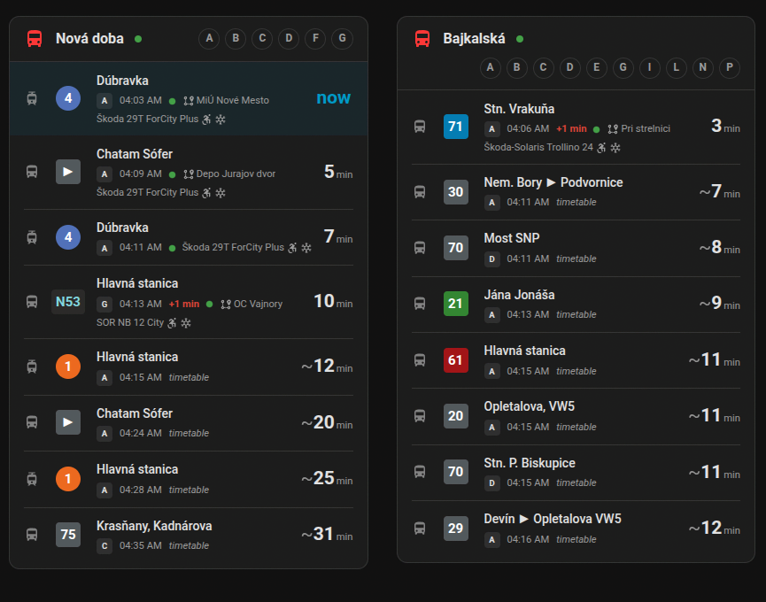
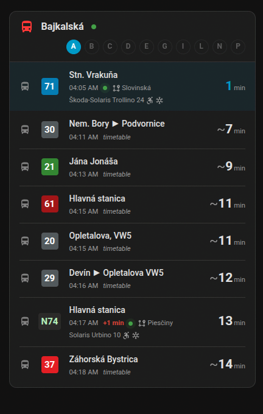
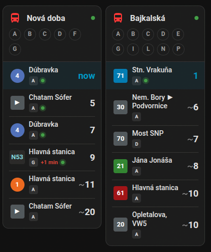

<p align="center">
  
</p>

<h1 align="center">Bratislava MHD for Home Assistant</h1>

<p align="center">
  <a href="https://my.home-assistant.io/redirect/hacs_repository/?owner=dmitthedazed&repository=ha-bratislava-mhd&category=integration"></a>
  <a href="https://my.home-assistant.io/redirect/config_flow_start/?domain=bratislava_mhd"></a>
</p>

<p align="center">
  <a href="https://github.com/dmitthedazed/ha-bratislava-mhd/actions/workflows/tests.yml"></a>
  <a href="https://github.com/dmitthedazed/ha-bratislava-mhd/actions/workflows/validate.yml"></a>
</p>

<p align="center"><b>English</b> · <a href="README.sk.md">Slovenčina</a></p>

When does my tram leave? This integration answers that on your dashboard: live departures
of Bratislava trams, trolleybuses and buses from the stops you choose. The imhd.sk live
board pushes the data, so there's no account or API key.

- You find stops on the map, by address or by name, and can mix all three. Then you tick
  the platforms you actually use.
- Each platform is a sensor. Its state is the minutes to the next departure; the rest of
  the board sits in the attributes.
- Delays are real-time. For live trips you also see where the vehicle is now and what it
  is: model, low floor, air conditioning.
- The card comes bundled. Tap a platform to see only its departures. It still reads fine
  in a narrow column.

<p align="center">
  
</p>

## Installation

You need Home Assistant **2025.1** or newer. Easiest is the "Add to HACS" button above (it
goes through [My Home Assistant](https://my.home-assistant.io/)). If that doesn't work:

1. HACS → ⋮ → **Custom repositories**.
2. Paste `https://github.com/dmitthedazed/ha-bratislava-mhd`, category **Integration**.
3. Find **Bratislava MHD** and click **Download**.
4. Restart Home Assistant.

<details>
<summary>Manual installation</summary>

1. Copy `custom_components/bratislava_mhd` into `<config>/custom_components/bratislava_mhd`.
2. Restart Home Assistant.

</details>

## Setup

Click "Add integration" above, or go to **Settings → Devices & services → Add integration →
Bratislava MHD**. Then pick how to find stops:

- **On the map.** The pin starts at your home. Move it and set a radius.
- **By address**, e.g. `Obchodná 10` or `Ružinov, Bajkalská`. OpenStreetMap looks it up
  within Slovakia.
- **By name.** Part of it is enough and diacritics are optional: `hodzovo` finds
  Hodžovo nám. Several at once go comma-separated: `hodzovo, trnavske myto`.

Need a stop the first search didn't find? Tick **Find more stops** and search again; what
you picked stays picked. On the last step you choose platforms. Every stop becomes a
device, every platform a sensor.

**Configure** on the integration changes how many departures a platform keeps. It also
lets you add or drop stops.

## Card

The `bratislava-mhd-card` ships with the integration, there's nothing extra to install.
After restarting HA, refresh the browser once (Ctrl+F5). You'll find it in the card picker
as **Bratislava MHD**; the visual editor asks which stop to show. In YAML:

```yaml
type: custom:bratislava-mhd-card
stop: 394             # stop id
platforms: [A, B]     # optional, all by default
max: 6                # optional
```

The platform letters in the card header are buttons. Tap one to filter, tap it again to go
back to all.

| Filter by platform | Narrow columns |
|:---:|:---:|
|  |  |

<details>
<summary>All card options</summary>

| Option | Default | Description |
|---|---|---|
| `stop` | | Stop id. The card picker fills in your first stop |
| `stops` | | Several stop ids, one card each. Without `stop` and `stops` you get every stop |
| `platforms` | all | Only these platforms, e.g. `[A, B]` |
| `max` | `6` | How many departures to show |
| `show_vehicle` | `true` | Vehicle model, low floor, air conditioning |
| `title` | stop name | Your own title |
| `entities` | all Bratislava MHD sensors | Pick platform sensors by hand |

</details>

## Sensors

One per platform, for example `sensor.hodzovo_nam_nastupiste_a`. The state is minutes to
the next departure, or `unknown` if nothing is due.

<details>
<summary>Attributes</summary>

`stop_id`, `stop_name`, `platform`, `connected`, `info` (service notices) and
`departures`, a list like this:

```yaml
- line: "4"
  headsign: Dúbravka
  expected: 1793070180     # epoch seconds, delay included
  scheduled: 1793070180
  minutes: 3
  delay: 0                 # minutes
  realtime: true           # false: timetable only
  stuck: false             # imhd.sk marks the vehicle as stuck
  last_stop: MiÚ Nové Mesto
  vehicle:
    type: Škoda 29T ForCity Plus
    low_floor: true
    ac: true
```

If imhd.sk drops the connection, the sensors keep the last board they had and reconnect by
themselves.

</details>

## Examples

<details>
<summary>Notify me 5 minutes before the next departure</summary>

```yaml
alias: "MHD: time to go"
triggers:
  - trigger: numeric_state
    entity_id: sensor.hodzovo_nam_nastupiste_a
    below: 6
actions:
  - action: notify.mobile_app_my_phone
    data:
      message: >-
        
        Line {{ d.line }} to {{ d.headsign }} leaves in {{ d.minutes }} min.
mode: single
```

</details>

<details>
<summary>Next departures in a Markdown card</summary>

```yaml
type: markdown
title: Hodžovo nám.
content: >-
  
  **{{ d.line }}** {{ d.headsign }}: {{ d.minutes }} min{{ ' (+%d)' % d.delay if d.delay > 0 }}
  
  _nothing in the next while_
  
```

</details>

## Where the data comes from

Departures come from the imhd.sk live board. Stop names, positions and platforms come from
a public stop catalogue at `api.magicsk.eu`. Addresses go to
[OpenStreetMap Nominatim](https://nominatim.org/), and only during setup.

Regional IDS BK buses show up only if imhd.sk lists them.

## License

GPL-3.0. This integration is unofficial and has nothing to do with Dopravný podnik
Bratislava, imhd.sk or IDS BK. The DPB name and logo belong to Dopravný podnik Bratislava;
they're here only so you know which network this is.
